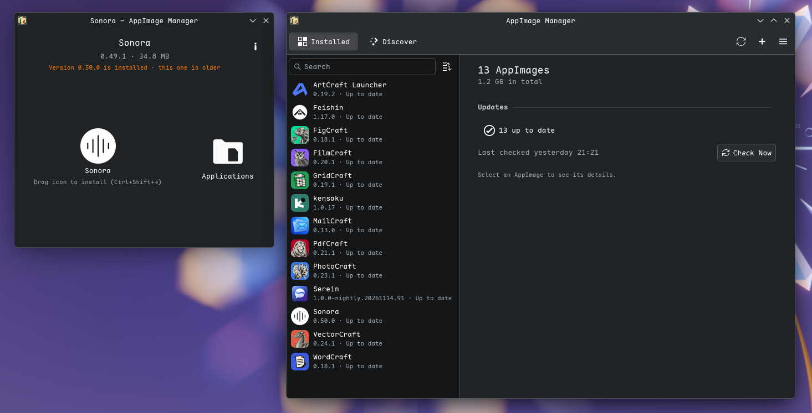
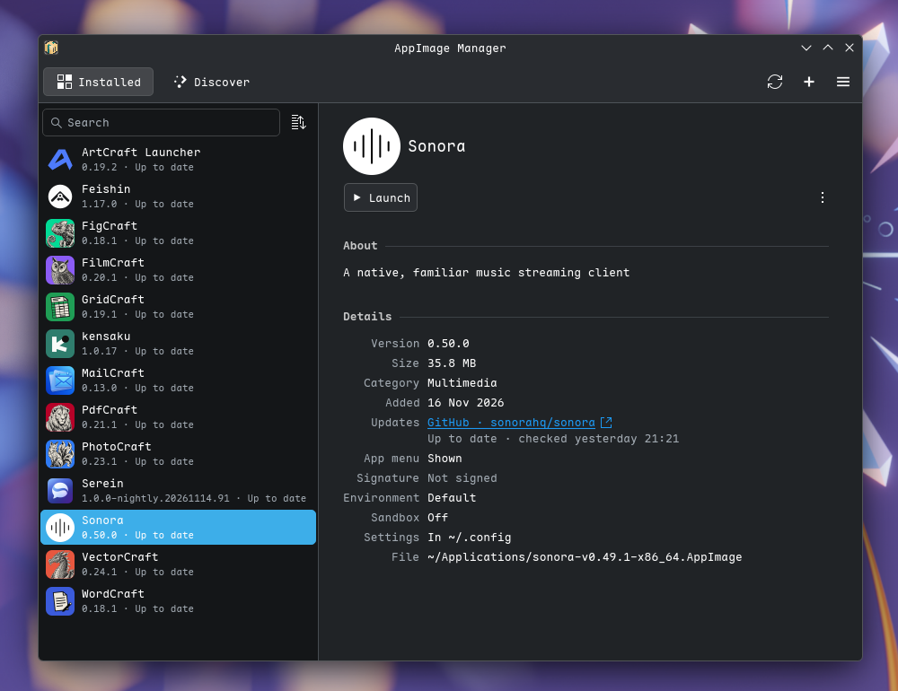
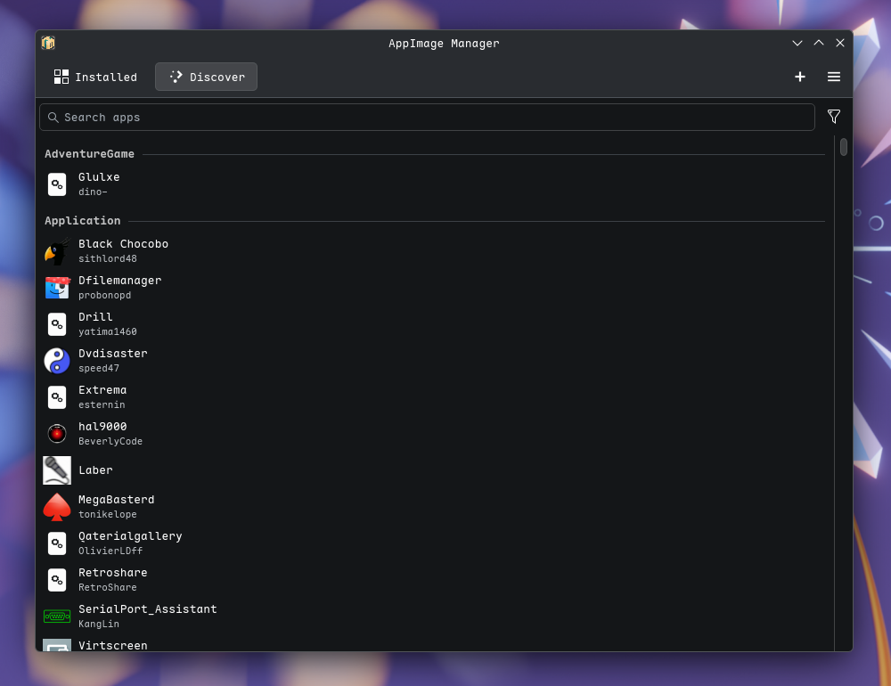

<div align="center">
    
    <h1><b>AppImage Manager</b></h1>
</div>

Install, update and remove AppImages on KDE Plasma 6.

Drop an AppImage on the window, or right-click it in Dolphin, and it goes into one Applications folder and, if you like, into your app menu. AppImage Manager checks your AppImages for updates and shows what's new in them, can run them in a sandbox, can find new apps in online catalogs, and cleans up after the apps you remove.

It doesn't care where your AppImages come from. Updates work from the information built into an AppImage, or from a GitHub, Codeberg, Forgejo or Gitea repository, a zsync file or a plain download link that you set yourself. The app catalogs are optional, and you can add your own.

This is version 2.2.0 (see [CHANGELOG.md](CHANGELOG.md)). I mostly test it on my own machine on Arch, so other distributions may need some work.

> [!NOTE]
> This project built with heavy AI assistance. It is an independent project and is not affiliated with or endorsed by KDE or KDE e.V.

## Screenshots







## Features

- Install an AppImage by dragging it onto the window, with the + button, or from Dolphin's right-click menu. AppImages in Downloads are moved, others (from a USB stick, say) are copied.
- Installing an app you already have? The install window tells you which version is installed and whether yours is newer or older, then lets you replace it (its update source, environment variables and app menu entry carry over), keep both, or cancel.
- Add an app to your app menu, or take it out again, with one click.
- All your AppImages in one list, each with its update state: up to date, a new version, no update source, or a failed check (and why). Apps with an update come first. Search, sort by name, size, category, date added or status.
- An overview while no app is selected: how many apps are up to date, have updates or no update source, and when they were last checked. Click a line to see just those apps.
- Check all AppImages for updates at once, read what's new in the release notes, then update one or all of them. If a new version misbehaves, go back to the one before with one click. Where an app publishes zsync files, only the parts that changed are downloaded.
- For apps released on GitHub, Codeberg, Forgejo or Gitea, the release notes of every new version, nicely formatted, and a link to the project from the details.
- Set where an AppImage is released when it doesn't say so itself: paste a repository, a zsync link or a download link and the kind is detected. Pre-releases are optional, the file for your CPU is picked for you, and a download that turns out to be a web page is refused.
- Keep an app's settings next to it, in `Applications/.config/<app>`, instead of in `~/.config`. Per app, or for every new install; existing settings can be moved along.
- Run an app, or all of them, in a sandbox (bubblewrap): it sees only its own folder and the folders you give it, not the rest of your home folder or other drives.
- Environment variables per app, for example `WEBKIT_DISABLE_DMABUF_RENDERER=1` for an app that shows a blank window. They apply when you start the app from AppImage Manager and from the app menu.
- Background update checks, daily, weekly, monthly or every few days. They pick up where they left off after a restart or suspend, wait while you are offline, and notify you once per new version.
- A system tray entry that shows how many updates are waiting. Click it for an overview of your AppImages and their update state, with Check Now and Update All; right-click for the menu. On Plasma it is a tray widget that opens like any other tray popup.
- A notification when an AppImage lands in your Downloads folder, with a button to manage it.
- Discover: browse and install apps from AppImage Hub and the AM database, or your own catalogs. It's off until you turn it on, so nothing is downloaded from catalogs unless you want it.
- Remove an app and choose which of its leftover settings and cache folders go with it. Everything goes to the Trash, nothing is deleted outright.
- Signatures: Details show whether an app is signed (and by which key), and an optional check before installing warns about unsigned AppImages and ones changed since they were signed.
- Looks and behaves like a Plasma app and follows your theme.

## Requirements

- KDE Plasma 6 (Qt 6.9 or newer and KDE Frameworks 6).
- `libappimage`, to read AppImages without mounting them.
- Recommended: `layer-shell-qt` (part of Plasma), so the tray window opens next to the tray on Wayland.
- Optional: `bubblewrap` to run apps in a sandbox, `gpg` for signature checks, and [am](https://github.com/ivan-hc/AM) to install apps from the AM database in Discover.

## Installation

### Arch Linux

Install from the AUR, either the latest release or the latest development version:

```sh
paru -S appimage-manager-plasma        # latest release
paru -S appimage-manager-plasma-git    # latest development version
```

Your AUR helper also installs `libappimage`, which is only in the AUR.

Or build the package yourself from a clone of this repository. For the latest release, run this in `packaging/appimage-manager-plasma`:

```sh
makepkg -si
```

Run it in `packaging/appimage-manager-plasma-git` instead for the latest development version from GitHub. You need `libappimage` from the AUR first.

To build the source you have checked out (with your own changes), run this in `packaging`:

```sh
makepkg -sif
```

The `-f` matters: without it, makepkg reinstalls a package it built earlier instead of building your changes.

### Other distributions

These aren't tested yet. Install the build dependencies (see below), then:

```sh
cmake --preset release
cmake --build --preset release
sudo cmake --install build/release
```

<details>
<summary><strong>Build dependencies</strong></summary>

Arch:

```sh
sudo pacman -S base-devel cmake extra-cmake-modules ninja \
    qt6-base qt6-declarative qt6-svg \
    kcoreaddons ki18n kconfig kio kiconthemes knotifications kcrash kdbusaddons \
    kirigami kirigami-addons kstatusnotifieritem layer-shell-qt gnupg
paru -S libappimage        # optional: am-git
```

Fedora:

```sh
sudo dnf install gcc-c++ cmake extra-cmake-modules ninja-build \
    qt6-qtbase-devel qt6-qtdeclarative-devel qt6-qtsvg-devel \
    kf6-kcoreaddons-devel kf6-ki18n-devel kf6-kconfig-devel kf6-kio-devel kf6-kiconthemes-devel \
    kf6-knotifications-devel kf6-kcrash-devel kf6-kdbusaddons-devel kf6-kstatusnotifieritem-devel \
    kf6-kirigami-devel kf6-kirigami-addons-devel layer-shell-qt-devel libappimage-devel gnupg2
```

Debian and Ubuntu (24.04 or newer):

```sh
sudo apt install build-essential cmake extra-cmake-modules ninja-build \
    qt6-base-dev qt6-declarative-dev libqt6svg6-dev \
    libkf6coreaddons-dev libkf6i18n-dev libkf6config-dev libkf6kio-dev libkf6iconthemes-dev \
    libkf6notifications-dev libkf6crash-dev libkf6dbusaddons-dev libkf6statusnotifieritem-dev \
    qml6-module-org-kde-kirigami qml6-module-org-kde-kirigamiaddons \
    liblayershellqtinterface-dev libappimage-dev gnupg2
```

openSUSE Tumbleweed:

```sh
sudo zypper in gcc-c++ cmake extra-cmake-modules ninja \
    qt6-base-devel qt6-declarative-devel qt6-svg-devel \
    kf6-kcoreaddons-devel kf6-ki18n-devel kf6-kconfig-devel kf6-kio-devel kf6-kiconthemes-devel \
    kf6-knotifications-devel kf6-kcrash-devel kf6-kdbusaddons-devel kf6-kstatusnotifieritem-devel \
    kf6-kirigami-devel kf6-kirigami-addons-devel layer-shell-qt6-devel libappimage-devel gpg2
```

</details>

## Usage

The first time you open AppImage Manager, one page asks for your Applications folder, whether to notify you about downloads, and whether to turn on Discover. You can change all of it later in Settings.

- **Install:** drag an AppImage onto the window or the drop box under the list, click +, or right-click the file in Dolphin and open it with **AppImage Manager**. If the app is already installed, the window says which version you have and asks whether to replace it or keep both.
- **Update:** click ⟳ in the toolbar (or ☰ → **Check for Updates**). A note at the bottom counts the AppImages as they are checked, then shows the result. Apps with an update move to the top of the list with their new version in green, and get an **Update to …** button; with several, **Update All** appears in the toolbar.
- **Tray:** click the AppImage Manager entry in the system tray for an overview of your AppImages and their update state; click an app to open it here. Middle-click checks for updates; right-click shows the menu.
- **More options:** select an app and click ⋯ for **Show in App Menu**, **Update Source…**, **Release Notes…** (apps updated from GitHub, Codeberg, Forgejo or Gitea), **Keep Settings in Applications**, **Sandbox…**, **Environment Variables…**, **Restore Previous Version** (after an update) and **Remove…**.

### Keys

| Key | What it does |
|---|---|
| Ctrl+F | Search |
| Enter | Start the selected app |
| Delete | Remove the selected app |
| Esc | Clear the search, then the selection |
| Ctrl+, | Settings |
| Alt+Left | Back from Settings or About |
| Ctrl+Q | Quit |

Drag the edge of the Installed list to make it wider or narrower; double-click it for the default width.

In the install window, Ctrl+Shift+→ installs the app (like dragging it onto Applications), and Enter starts it once it's installed.

### From the command line

| Command | What it does |
|---|---|
| `appimagemanager` | Opens the main window |
| `appimagemanager /path/to/app.AppImage` | Opens the install window for that file |
| `appimagemanager --settings` | Opens the main window on Settings |
| `appimagemanager --select /path/to/app.AppImage` | Opens the main window with that AppImage selected |
| `appimagemanager --run /path/to/app.AppImage` | Starts the AppImage with its settings (environment, settings folder, sandbox); app menu entries of sandboxed apps use it |
| `appimagemanager --daemon` | Runs the background update checker and tray icon (starts at login by itself) |

## Settings

Open them from the menu (☰), or with Ctrl+,. The pages are listed on the left:

- **General:** the Applications folder, where new apps keep their settings, the drop box under the list, the overview, and notifications
- **Updates:** how often to check in the background
- **Security:** signature checks, the reminder that AppImages aren't verified, and the sandbox: sandbox all AppImages, and the folders every sandboxed app may use
- **Discover:** turn it on or off, and which app catalogs it searches, in which order, including your own

**Restore Defaults** is under the list of pages.

## Troubleshooting

**An app shows a blank or broken window.** Many apps built with WebKit or Electron need an environment variable on some systems. Select the app, click ⋯ → **Environment Variables…** and add, for example, `WEBKIT_DISABLE_DMABUF_RENDERER=1`.

**An AppImage never gets updates.** It probably doesn't say where it is released. Click ⋯ → **Update Source…** and paste its repository or download link. The line under the field shows what was detected; pick another type there if it guessed wrong.

**I rebuilt with makepkg but nothing changed.** Use `makepkg -sif`, see [Arch Linux](#arch-linux). Then close AppImage Manager completely and start it again: a window that is still open just comes to the front.

**pacman says files already exist.** They came from an earlier `sudo cmake --install`. Remove them with `sudo xargs rm < build/release/install_manifest.txt` (or `build/dev/…`), then install again.

**Dolphin still shows "Manage AppImage".** Versions up to 2.1.0 added that entry; it is gone now that AppImage Manager is under **Open With**. If you installed with CMake, remove the old files: `sudo rm /usr/lib/qt6/plugins/kf6/fileitemaction/appimagemanager.so /usr/share/kio/servicemenus/appimagemanager.desktop`. The package does this for you.

**A sandboxed app can't open or save my files.** It only sees its own folder and the folders it was given. Add the folder in ⋯ → **Sandbox…** for that app, or for every sandboxed app under Settings → Security → Shared folders.

**An app doesn't start in the sandbox.** Some apps need more than the sandbox allows. Leave that one out: ⋯ → **Sandbox…** → turn off **Run in a sandbox**. A sandboxed app also starts without the settings it had in `~/.config`; move them first with ⋯ → **Keep Settings in Applications**.

**I want to see what AppImage Manager is doing.** Turn on its debug output in `kdebugsettings` (search for "appimagemanager"), or start it from a terminal with:

```sh
QT_LOGGING_RULES="appimagemanager.debug=true" appimagemanager
```

Bugs and ideas are welcome in the [issue tracker](https://github.com/strandzen/AppImage-Manager/issues).

## Uninstall

With the package: `sudo pacman -R appimage-manager-plasma` (or `appimage-manager-plasma-git`). With CMake, in the source folder:

```sh
sudo xargs rm < build/release/install_manifest.txt
```

Your AppImages stay in your Applications folder, along with `.config` (settings of apps kept there) and `.previous` (the versions updates replaced). Remove app menu entries you don't want first (⋯ → **Show in App Menu**), or delete the `appimage_*.desktop` files in `~/.local/share/applications`.

## Translations

AppImage Manager is translated into Czech, Dutch, French, German, Italian, Japanese, Norwegian (Bokmål), Polish, Portuguese (Brazil), Russian, Simplified Chinese, Slovak, Spanish, Turkish and Ukrainian. Most of the text in these languages is a machine-made draft, marked "fuzzy" in the translation files, so it still shows in English until a native speaker checks it. If you speak one of them, reviewing the drafts helps a lot: edit `po/<language>/appimagemanager.po`, fix what reads wrong, and remove the `fuzzy` mark. For a new language, copy `po/appimagemanager.pot`.

## License

GPL-2.0-or-later. See [LICENSES/GPL-2.0-or-later.txt](LICENSES/GPL-2.0-or-later.txt).
